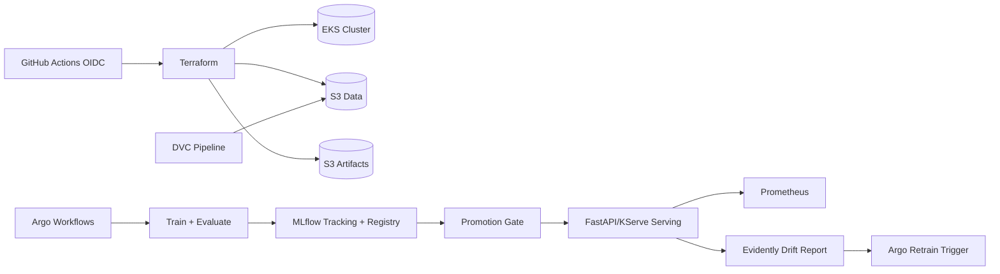

# mlops-pipeline-eks

Portfolio-quality MLOps pipeline on Amazon EKS with reproducible training, tracked experiments, gated model promotion, deployment, and drift monitoring.

## Problem statement
Build an explainable, low-cost (CPU-only) MLOps platform that automates:

1. Data versioning
2. Training/evaluation + experiment tracking
3. Model registry + gated promotion
4. Serving and monitoring
5. Drift-triggered retraining

## Repository layout

```text
mlops-pipeline-eks/
  terraform/
  pipelines/
  src/
  serving/
  monitoring/
  k8s/
  tests/
  .github/workflows/
  docs/
  Makefile
  dvc.yaml
  README.md
```

## Architecture



## Milestones implemented in this scaffold

1. Repo scaffold: `.gitignore`, pre-commit, `Makefile`, CI baseline with AWS OIDC
2. Terraform baseline for S3, ECR, IRSA IAM roles, and AWS budget alert
3. Kubernetes values/manifests for MLflow, Argo, and serving
4. DVC workflow and validation script with tests
5. Training/evaluation modules logging to MLflow
6. Promotion gate logic with explicit metric threshold rule
7. FastAPI serving app and CI smoke-test workflow
8. Monitoring files (Prometheus rule, Evidently config, drift script)
9. Documentation and teardown path (`make down`)

## Promotion rule

A candidate model is promoted only when:

- validation/schema checks pass, and
- `candidate_accuracy - production_accuracy >= 0.01`

If no production model exists, the first validated model is promotable.

## Quick start

1. Install Python dependencies:
   ```bash
   pip install -r requirements-dev.txt
   ```
2. Validate code:
   ```bash
   make lint
   ```
3. Run tests:
   ```bash
   make test
   ```
4. Run local training pipeline:
   ```bash
   make train
   ```
5. Generate infrastructure plan:
   ```bash
   make up
   ```

## CI/CD and security quality controls

- GitHub Actions uses OIDC (`aws-actions/configure-aws-credentials`) to avoid long-lived AWS keys.
- Pre-commit includes Terraform checks, Ruff, and key leak detection.
- Terraform resources are least-privilege with scoped S3 actions.
- ECR scan-on-push is enabled.

## Monitoring and drift demo

`make drift-demo` computes a statistical drift score and emits `monitoring/drift_result.json`.
When drift score exceeds threshold, retraining should be triggered through the Argo workflow.

## What can go wrong

- Incorrect OIDC provider details break IRSA role assumption.
- Missing bucket name substitutions in `k8s/*-values.yaml` break MLflow artifact logging.
- Promotion gate thresholds that are too strict can block needed updates.
- Drift threshold too low can cause expensive retraining loops.

## Cost notes

- CPU-only workloads and single-replica defaults keep cost low.
- AWS Budget alert is provisioned in Terraform and should be configured with an active email.

## Teardown verification

Destroy billable resources with:

```bash
make down
```

After teardown, verify in AWS that S3 buckets, ECR repos, IAM roles, and budget artifacts are removed or intentionally retained.
